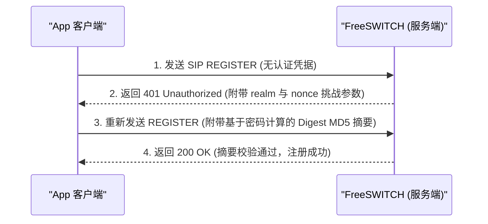
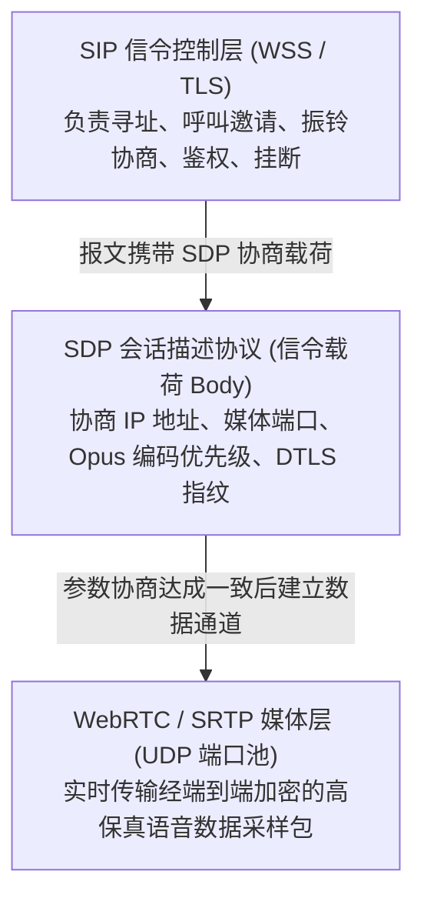
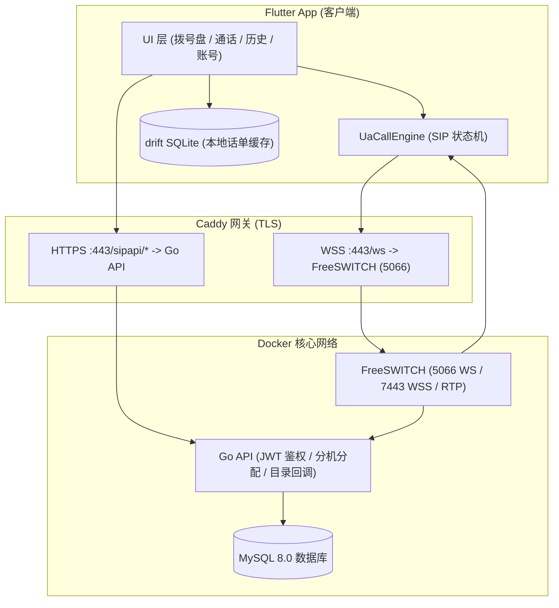
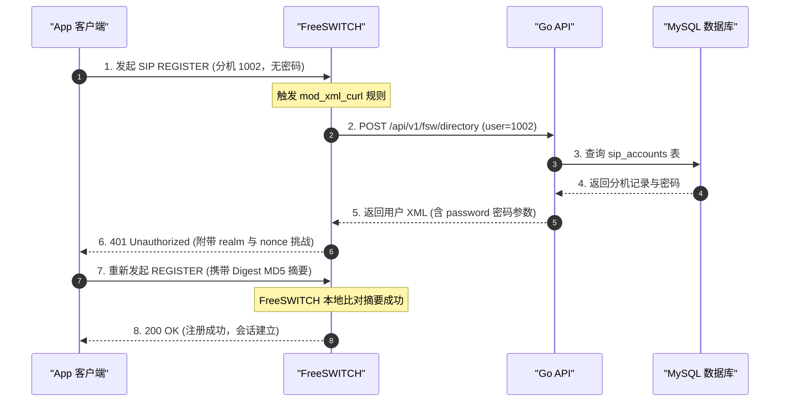
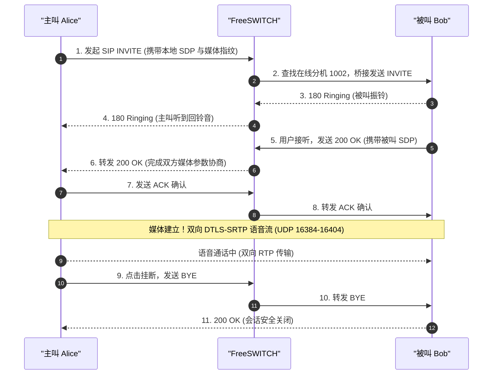
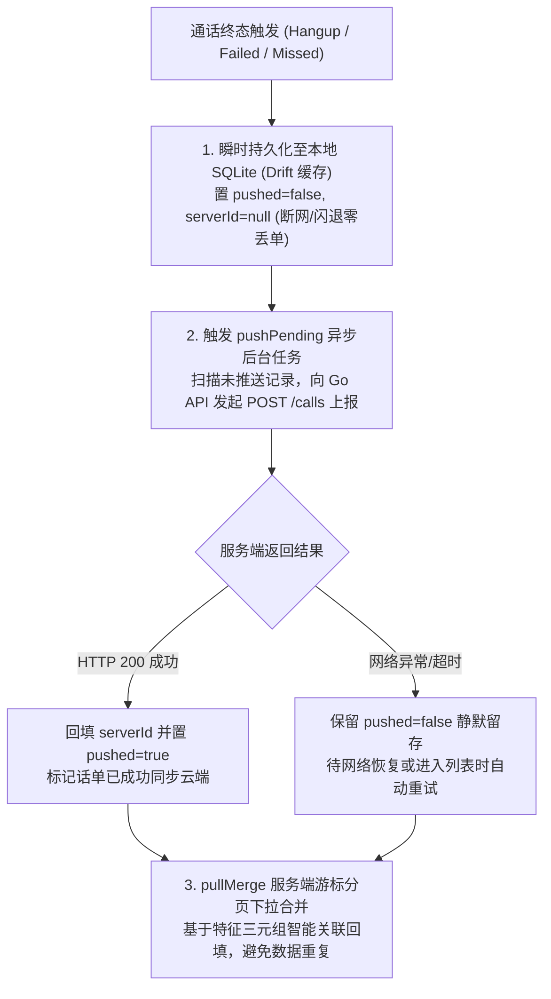

刷抖音刷到了别人实现的sip软电话，感觉还挺有意思，就研究了研究

在 [SIP Terminal](https://github.com/NowPion/SIP_terminal) 中落地了一套完整的软电话通信系统：**Flutter Android App + Go API + FreeSWITCH + MySQL**。

本文将从第一性原理出发，深入浅出地拆解：**什么是 SIP？什么是 `safarov/freeswitch`？整套系统的架构如何设计？以及为什么要做出这样的技术选型与架构实现？**

---

## 一、 什么是 SIP？

很多初学者容易将 SIP 与“实时语音流”混为一谈，以为音频数据就是通过 SIP 协议传输的。**这是最大的误区。**

> **定义**：SIP（Session Initiation Protocol，会话发起协议，由 IETF 在 RFC 3261 中定义）是一个**应用层信令控制协议**。
> 它**只负责会话的“建立、修改和终止”**，其本身**绝对不承载任何实际的音频或视频媒体流数据**。

我们可以把 SIP 直观地理解为**电信世界的“HTTP”**：
- **纯文本格式**：报文由请求行/状态行、报文头（Headers）和报文体（Body）组成，人眼可读；
- **请求/响应模型**：客户端发送请求方法（Method），服务端返回三位数字的状态码（Status Code）；
- **URI 寻址机制**：类似 `sip:1001@fs.local` 或 `sip:alice@example.com`，像邮箱与网页地址一样支持域名与分机路由。

  
  

### 1.1 核心请求方法（Methods）

| 方法 | 含义 | 类比 / 场景 |
| :--- | :--- | :--- |
| **`REGISTER`** | 软电话向服务器登记当前网络位置（IP:Port）与分机绑定关系 | 客户端上线打卡，告诉服务器“我在这，有我的电话发给我” |
| **`INVITE`** | 发起呼叫邀请，携带本端的媒体能力（SDP） | 打电话发起呼叫 |
| **`ACK`** | 最终确认收到 INVITE 的成功响应（200 OK） | 建立三次握手的最终凭据 |
| **`BYE`** | 终止已建立的通话会话 | 任意一方挂断电话 |
| **`CANCEL`** | 在呼叫尚未被接听前取消该次呼叫请求 | 主叫方在对方响铃但未接前主动放弃挂断 |
| **`UPDATE / INFO`** | 在通话过程中动态协商媒体参数或传递带外信息 | 如通话中切换编解码或传递 DTMF 按键音 |

### 1.2 关键状态码机制：为什么 401 不是错误？

SIP 的状态码与 HTTP 高度相似：
- **`1xx` 临时响应**：`100 Trying`（服务器处理中）、`180 Ringing`（对端正在响铃）、`183 Session Progress`（媒体早期彩铃协商）；
- **`2xx` 成功**：`200 OK`（呼叫接通/操作成功）；
- **`4xx` 客户端失败**：`403 Forbidden`（禁止）、`486 Busy Here`（对方占线）；
- **`5xx / 6xx` 服务端与全局错误**：`503 Service Unavailable`、`603 Decline`（对方明确拒接）。

特别需要强调：**`401 Unauthorized` 在 SIP 注册中是必经的正常流程，绝非系统错误！**

SIP 采用了同 HTTP 相同的摘要认证（Digest Authentication）：
1. 客户端第一次发送裸 `REGISTER` 请求；
2. 服务器拒绝并返回 `401 Unauthorized`，在响应头 `WWW-Authenticate` 中附带随机密钥串 `nonce` 与认证域 `realm`；
3. 客户端利用本地保存的密码与 `nonce` 计算 MD5 摘要，重新发送携带 `Authorization` 头的 `REGISTER`；
4. 服务器验证摘要一致，返回 `200 OK`，注册成功。

### 1.3 信令与媒体分离机制（Signaling vs Media）

通信系统中最重要的设计模式就是**控制面（信令）与数据面（媒体）彻底解耦**：

- **信令层**：通过 SIP 报文完成寻址和状态扭转；
- **协商层（SDP，RFC 4566）**：SIP 报文的正文是 SDP 文本，里面声明了本端的 IP、端口、音频格式优先级（如 Opus、G.711 PCMU/A）、加密指纹（DTLS 指纹）等；
- **媒体层（RTP / WebRTC）**：双方协商完毕后，建立高速 UDP 数据通道，语音流直接通过 RTP/SRTP 传送，不再占用信令信道。

---

## 二、 什么是 `safarov/freeswitch`？

在软电话架构中，我们需要一台“交换机”（PBX / 软交换系统）来负责分机状态维护、呼叫路由、信令转接与音视频转码。而 **FreeSWITCH** 就是当今开源界最成熟、性能最强悍的电信级 B2BUA（背对背用户代理）软交换核心。

但在实际落地中，如果你去从零源码编译 FreeSWITCH，极大概率会陷入“依赖地狱”：
- 官方源网络受限，SignalWire 接入需要商业凭据与认证 Token；
- 涉及 WebRTC、OpenSSL、Libwebsockets、Opus、Spandsp 等几十个底层音视频 C/C++ 依赖库的编译；
- 平台环境差异（CentOS、Ubuntu、Debian）极易导致动态链接库符号冲突。

这正是我们选用 **`safarov/freeswitch`** Docker 镜像的原因。

### 2.1 为什么选择 `safarov/freeswitch`？

1. **官方与社区事实上的标准**：
   由 FreeSWITCH 资深维护者 Sergey Safarov 长期维护，是 Docker Hub 上下载量最多、成熟度最高的预编译镜像（Debian 基础底座）。
2. **WebRTC 模块开箱即用**：
   原生集成了对现代软电话至关重要的核心模块：
   - `mod_sofia`：SIP 协议栈核心实现；
   - `mod_xml_curl`：支持通过 HTTP/RESTful 动态获取配置文件和分机目录（整套系统无静态配置的核心基石）；
   - `mod_opus`：默认开启当今音质最好、弱网抗性最强的 Opus 语音编解码器；
   - `mod_verto` / `mod_rtc`：完备的 WebRTC DTLS-SRTP 媒体转码能力。
3. **极简运维与编排**：
   配合 Docker Compose，仅需挂载定制的 `/etc/freeswitch` 配置目录卷，就能在单台服务器或本地开发机上一键拉起生产级别的电信交换服务，避免数十小时的源码编译泥潭。

---

## 三、 系统总体架构设计

本项目遵循 **前后端分离、信令与媒体解耦、无状态交换网关** 的现代化云原生架构。

### 3.1 架构拓扑图

### 3.2 模块职责分工

| 组件名称 | 核心技术栈 | 核心职责与设计原则 |
| :--- | :--- | :--- |
| **Flutter 客户端** | Flutter, Riverpod, `sip_ua`, `flutter_webrtc`, `drift`, `go_router` | 提供极简美观的跨平台软电话体验；负责本地 SIP 状态驱动、音频硬件控制、离线数据库缓存与高优先级通知保活。 |
| **FreeSWITCH 交换机** | `safarov/freeswitch:latest` (`mod_sofia`, `mod_xml_curl`) | 纯粹的无状态 SIP 交换节点与媒体代理；不保存任何静态分机文件，所有认证实时回调外部 API。 |
| **Go 业务 API** | Go 1.23, Gin, GORM, bcrypt, golang-jwt | 处理业务账号体系、JWT 发放、分机号并发安全分配；作为 FreeSWITCH 的 `xml_curl` 认证提供端。 |
| **MySQL 数据库** | MySQL 8.0 (InnoDB) | 统一持久化存储用户账号、SIP 密码与通话记录，提供全局唯一约束兜底。 |
| **Caddy 网关** | Caddy v2 (自动 TLS + WebSocket 反代) | 统一证书管理；公网 443 统一收敛；严格隔离内网鉴权接口。 |

---

## 四、 核心业务链路时序剖析

### 4.1 动态目录认证注册链路（App 上线）

与传统需要在交换机写死配置不同，本系统的分机信息完全保存在 MySQL 中：

#### 核心注册阶段拆解

| 交互阶段 | 动作与通信流向 | 协议载荷与鉴权机制 |
| :--- | :--- | :--- |
| **1. 首发注册** | `App ➔ FreeSWITCH ➔ Go API` | 客户端发起无凭证 `REGISTER`；FS 拦截并通过 `mod_xml_curl` 触发 POST 查库 |
| **2. 认证挑战** | `Go API ➔ FreeSWITCH ➔ App` | Go API 查库返回目录 XML（含密码）；FS 下发 `401 Unauthorized`（附带 realm 与 nonce） |
| **3. 摘要确认** | `App ➔ FreeSWITCH` | 客户端利用本地密码与 nonce 现场计算 Digest MD5 重发；FS 校验成功返回 `200 OK` 完成注册 |

### 4.2 呼叫与 WebRTC 媒体建立链路（通话建立）

#### 核心通话建立拆解

| 通话阶段 | 动作与通信流向 | 协议载荷与媒体协商 |
| :--- | :--- | :--- |
| **1. 呼叫发起** | `主叫 Alice ➔ FS ➔ 被叫 Bob` | Alice 发起 SIP `INVITE`，载荷为本端音频能力的 SDP Offer；FS 检索在线分机并桥接转呼 Bob |
| **2. 振铃响应** | `被叫 Bob ➔ FS ➔ 主叫 Alice` | Bob 客户端振铃并返回 `180 Ringing`；FS 转送 Alice 触发本地回铃音 |
| **3. 接听应答** | `被叫 Bob ➔ FS ➔ 主叫 Alice` | Bob 点击接听返回 `200 OK` (含被叫 SDP)；Alice 发送 `ACK` 确认完成三次握手 |
| **4. 语音互通** | `Alice ⮂ (DTLS-SRTP) ⮂ Bob` | WebRTC 媒体通道就绪，双向传输经端到端加密的高保真 Opus 音频流（UDP 16384-16404） |
| **5. 挂断终态** | `任意一方 ➔ FS ➔ 对端` | 用户点击挂断发送 `BYE`，对端确认 `200 OK`；双方断开媒体流，本地 SQLite 瞬时落库并异步上报话单 |

---

## 五、 为什么这样实现？—— 架构选型与深度权衡

技术选型不仅是罗列框架，更是面对现实约束时的工程权衡。本节详细阐述为什么选择这套架构，以及它解决了哪些经典工程痛点。

### 5.1 为什么用 WebRTC 代替传统的“裸 RTP”？

在传统 VoIP（如早期 IP 话机）中，SIP 呼叫建立后，两端直接开放随机 UDP 端口跑裸 RTP 流。但在现代移动互联网环境下，裸 RTP 会遭遇致命痛点：

1. **极其脆弱的 NAT 穿透与“单通/断流”**：
   手机连接的是运营商 4G/5G 复杂的对称 NAT（Symmetric NAT）或家庭路由器防火墙。两台手机如果直接直连发送 UDP，防火墙根本不允许外部未打洞的包入站，导致**“电话打通了但听不到声音（单通）”**甚至完全无声。
2. **缺乏加密，存在巨大窃听风险**：
   传统 RTP 是纯明文，中间路由器任何抓包工具都可以直接重现语音内容。
3. **移动端声学处理极其复杂**：
   手机通话必须要处理**回声消除（AEC）、噪声抑制（ANS）、自动增益（AGC）**，否则扬声器播放出来的声音会再次被麦克风录制回传，造成尖锐刺耳的啸叫或回音。

**WebRTC 的降维打击优势**：
- **DTLS-SRTP 默认安全**：所有媒体传输在传输层强制进行端到端加密；
- **ICE / STUN 完善打洞**：集成完整的交互式连通性建立（Interactive Connectivity Establishment），自动探测公网反射地址；
- **专业级声学引擎**：`flutter_webrtc` 底层使用的是 Google 开源的 WebRTC 原生 C++ 音视频引擎，自动调优系统的硬件回声消除与防抖动缓冲（Jitter Buffer），在极高丢包率下依然维持语音可懂度。

### 5.2 为什么用 SIP over WebSocket (WSS) 代替 UDP/TCP 5060？

传统 SIP 默认监听在 UDP 5060 端口。但在移动 App 上采用纯 UDP 5060 会面临灾难性后果：
- **运营商封锁与 QoS 降级**：很多公共 Wi-Fi、公司局域网甚至移动运营商的基站网关，出于安全防范直接阻断非 HTTP 端口或将 5060 端口降级丢弃；
- **NAT 映射过快老化**：UDP 穿透建立的虚拟映射在路由器上通常只有 30 秒寿命，一旦手机进入锁屏或稍无心跳，链路就被路由器无情斩断，导致来电根本推不下来；
- **TLS 证书标准化**：WSS（WebSocket Secure）运行在标准 TLS 之上（复用 443 或专属 7443 端口），流量外观与普通安全 Web 流量毫无二致，天然穿透各类防火墙，同时彻底杜绝了信令被窃听和中间人篡改。

### 5.3 为什么用 `mod_xml_curl` 动态目录？

**痛点场景**：
在传统 FreeSWITCH 部署中，增加一个分机 1001，管理员需要登录服务器，在 `/etc/freeswitch/directory/default/` 目录下创建一个 `1001.xml` 文件，写死用户名和密码，然后进入 `fs_cli` 执行 `reloadxml`。
这在互联网业务中完全不可行 —— **用户可能每秒都在注册，难道每注册一个用户就要写一次服务器磁盘并重载全量 XML？** 这会导致巨大的 I/O 竞争与交换服务卡顿。

**动态目录（`mod_xml_curl`）的破局点**：
- **完全解耦与无状态**：FreeSWITCH 内部一张分机表都不存，只充当“计算与转发管道”。每当收到注册，它把请求交给 Go API 接口；
- **“数据库即目录”**：Go API 直接查 MySQL，有则返回 XML，无则返回 404 XML。
- **瞬时生效**：用户刚刚在 App 上注册成功，秒级内就可以直接发起 SIP 注册，无需重启任何服务，零同步成本。

### 5.4 为什么动态目录接口返回明文密码，而不是预计算的 `a1-hash`？

这是在开发此类系统时极容易踩中、并导致连续几天毫无头绪的隐蔽陷阱！

根据 SIP 规范，用户密码在服务器端可以存成哈希值 `a1-hash = MD5(username:realm:password)`，这样服务器不需要知道明文。很多人第一反应是“为了安全，Go API 查库后应该只给 FreeSWITCH a1-hash”。

**但这里有一个深层冲突**：
- FreeSWITCH 的 profile 通常配置了 `challenge-realm=auto_from`，即**挑战认证域（realm）是动态的**，它跟随客户端发起 `REGISTER` 报文头中的域名或 IP（例如客户端如果在局域网填 `192.168.1.10`，realm 就是 `192.168.1.10`；如果在模拟器中填 `10.0.2.2`，realm 就是 `10.0.2.2`；生产环境则是 `api.example.com`）；
- 如果 Go API 返回 `a1-hash`，这个哈希值必须在写入数据库前绑定一个固定的 realm。一旦客户端连接使用的 host 发生变化，两端计算的 MD5 输入不一致，就会**永远鉴权失败，报 401/403**！
- **正确做法**：Go 内部为每个分配的分机生成 20 位高强度随机密码存入库中，`fsw/directory` 接口将明文密码通过 XML 喂给 FreeSWITCH。FreeSWITCH 接收到后，**利用当前请求真实的 realm 现场计算 MD5 进行动态校验**，完美兼容任意复杂的网络接入拓扑。
- **安全边界保障**：该接口只下发 SIP 随机密码（非用户登录密码），且**强制绑定内网 Docker 容器间通信**，在反向代理（Caddy）层直接对公网路由 `/api/v1/fsw/*` 施加严格的 403 阻断，外部公网绝不可达。

### 5.5 为什么话单采用“离线优先（Offline-first）”双向同步？

在移动端做 VoIP，网络环境极其脆弱：用户可能在地下车库、电梯或者移动切换基站的瞬间挂断通话。

如果采用传统的“通话结束立刻发 HTTP 请求给服务器记录”：
- 一旦此时断网，HTTP 抛出异常，**话单在客户端与服务端彻底永久丢失**；
- 如果重试机制设计不当，网络恢复后可能多次重发，导致生成重复账单。

**本项目采用的工业级解法（`sync_repository.dart`）**：

---

## 六、 生产级踩坑排查实录（经验总结）

在整套系统的打通与落地过程中，我们总结了几个最关键的“排错大坑”，供同行参考：

### 1. FreeSWITCH 报 `403 Can't register a pointer`
- **现象**：客户端配置的分机号与密码确认无误，但无论如何注册都返回 403，日志显示命中静态 pointer 占位符。
- **根因**：FreeSWITCH 内部带有一套默认的 vanilla 样例配置，里面把 1000-1014 声明为了外部指针。当容器名变更（如从 `go-api` 改为 `sip-api`）导致 `xml_curl.conf.xml` 里的 URL 无法解析时，**FreeSWITCH 不会向上抛错，而是静默回退使用本地静态文件**，从而抛出无法注册 pointer 的诡异错误。
- **解法**：保证 Docker Compose 网络内服务别名与 `gateway-url` 绝对一致；在 Go 动态目录中补充 domain 接管模板，彻底切断静态目录回退。

### 2. Android 14+ 麦克风前台服务闪退（拨打瞬间 Crash）
- **现象**：在 Android 14 (API 34) 模拟器或真机上，刚点击呼叫或刚完成注册，应用直接闪退杀死。
- **根因**：Android 14 引入了极其严格的前台服务管控。如果应用在 `AndroidManifest.xml` 中声明了 `foregroundServiceType="microphone"`，**系统要求在启动前台服务之前，必须已经在前台显式获得了系统的麦克风运行时权限（`RECORD_AUDIO`）**；如果在尚未授权的状态下强行启动前台保活服务，系统底层会直接抛出 `SecurityException` 强制 Crash 终止进程。
- **解法**：启动流程与权限状态强关联，在用户首次进入拨号盘或启动服务前前置鉴权，未取得麦克风权限时降级启动无特殊类型的保活通知，待拨号前拦截申请，授权后再挂载录音管道。

### 3. Caddyfile 单文件挂载的 Inode 陷阱
- **现象**：在宿主机上修改了 Caddy 的配置文件，但网关反代路由依然不生效。
- **根因**：在 Linux/Windows 上，很多编辑器（或 `mv` 命令）保存文件时采用的是“写新临时文件 + 原子重命名覆盖”，这会导致原文件的 Inode 发生改变。而 Docker 的单文件 `bind mount` 绑定的是底层的 Inode 引用，外部改动后容器内读取的依旧是旧文件的物理块。
- **解法**：原地覆写（`cat new.conf > caddy.conf`）或者直接挂载配置所在的上层目录，而非挂载单个孤立文件。

---

## 七、 结语与开源

构建一套稳定高可用的 SIP 软电话，绝非简单拼接几个开源库，它涉及信令状态机的高内聚收敛、WebRTC 底层音频流的高效捕获、边缘反代与交换网关的动态鉴权编排，以及移动端恶劣弱网环境下的离线容错设计。

本项目以最小的资源代价（单台轻量云服务器即可轻松支撑上百路并发语音），打通了现代移动端（Flutter）与传统电信通信（FreeSWITCH）的边界，实现了全流程无状态、全动态扩容的云原生软电话架构。

本项目全部代码均已开源：
- **项目仓库**：[GitHub - NowPion/SIP_terminal](https://github.com/NowPion/SIP_terminal)
- **核心组件**：
  - `sip_terminal_app/`：Flutter Android 软电话 App
  - `server/`：Go 1.23 RESTful API & 动态目录服务
  - `deploy/`：FreeSWITCH 与 Docker 快速部署编排配置

欢迎在实际业务落地、企业内部私有通信调度、SIP 协议深入研究中交流探讨与提出 Issue！

