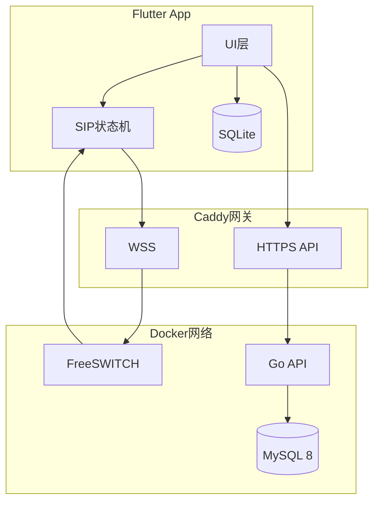

# SIP 软电话实现：从协议到全栈落地

本文基于我实际落地的一套 SIP 软电话系统（Flutter 安卓 App + Go API + FreeSWITCH + MySQL + Caddy），先讲清楚 **SIP 协议本身是什么**，再拆解整个项目的架构、关键链路与踩坑记录。所有内容均来自真实可运行的服务器部署，而非纸上谈兵。

>  项目源码：[github.com/NowPion/SIP_terminal](https://github.com/NowPion/SIP_terminal)

---

## 一、什么是 SIP

<div style="display:flex;gap:24px;justify-content:center;margin:20px 0">
  
  
</div>

SIP（Session Initiation Protocol，RFC 3261）是一个**应用层信令协议**，只负责"建立、修改、终止会话"，本身不传输语音。可以把它理解为电话世界的"HTTP"——文本协议、请求/响应模型、状态码语义都高度相似。
### 1.1 请求方法

| 方法 | 作用 |
|---|---|
| REGISTER | 注册当前位置（软电话上线） |
| INVITE | 发起呼叫 |
| ACK | 确认最终响应 |
| BYE | 挂断 |
| CANCEL | 取消未应答的呼叫 |
| UPDATE/INFO | 会话中透传信息 |

### 1.2 响应码

| 类别 | 含义 | 常见 |
|---|---|---|
| 1xx | 临时响应 | 100 Trying、180 Ringing（振铃）、183 进展 |
| 2xx | 成功 | 200 OK |
| 3xx | 重定向 | 302 |
| 4xx | 客户端失败 | 401 Unauthorized（发起摘要认证挑战）、403、486 Busy |
| 5xx/6xx | 服务端/全局失败 | 503、603 Decline |

注意 **401 不是错误**：SIP 的注册认证就是"客户端先 REGISTER → 服务器回 401 携带 nonce → 客户端带上 MD5 摘要重发 → 200 OK"，与 HTTP Digest 同源。

### 1.3 信令与媒体分离

- **信令**：SIP 报文（文本），走 UDP/TCP，或 WebSocket（WS/WSS）
- **媒体**：语音由 **RTP**（实时传输协议）承载，端口、编解码等参数通过 **SDP**（随 INVITE/200 OK 的正文）协商
- 软电话场景常用 **WebRTC** 做媒体层：DTLS-SRTP 加密、ICE 打洞、回声消除都白送，浏览器和移动端支持完善

---

## 二、系统总体架构

<div style="max-width: 650px; margin: 20px auto; overflow-x: auto;">



</div>

### 2.1 组件职责

| 组件 | 技术 | 职责 |
|---|---|---|
| Flutter App | sip_ua + flutter_webrtc + Riverpod + drift | UI、SIP 注册/呼叫、本地通话记录缓存与同步 |
| FreeSWITCH | safarov/freeswitch 镜像 | SIP 注册认证、呼叫桥接、RTP 转发 |
| Go API | Gin + GORM + JWT | 用户注册登录、分机分配、话单存储、**动态目录回调** |
| MySQL | 8.0 | users / sip_accounts / call_records |
| Caddy | 复用同机已有实例 | HTTPS 反代 API、WebSocket 反代 /ws → FS |

核心设计点：**FreeSWITCH 不静态配置分机**，而是通过 `mod_xml_curl` 把目录查询实时回调给 Go API——注册一个用户就自动拥有一个 SIP 分机，零同步成本。

### 2.2 关键链路

**注册链路**（App 上线）：

```
App ──REGISTER──► FS ──POST /fsw/directory(user=1002)──► Go API ──► MySQL
App ◄──401+nonce── FS ◄──────────目录XML(密码)──────────┘
App ──REGISTER+Digest摘要──► FS ──校验──► 200 OK（REGED）
```

**呼叫链路**：

```
A ──INVITE(SDP)──► FS：查被叫是否在线 ──► 桥接 ──INVITE──► B 振铃
B ──200 OK(SDP)──► FS ──ACK──► 双向 RTP 语音
```

拨号计划只需一条：4 位数字 → `bridge user/$1@$${domain}`。

**话单链路**：通话结束 → App 本地 SQLite 先落库（保证离线不丢）→ 尽力上报 `POST /calls` → 游标分页拉取合并（按 serverId 去重回填）。

---

## 三、服务端实现要点（Go）

### 3.1 分机原子分配

注册即分配最小空闲分机（从 1001 起），必须处理并发：

```go
func (s *Store) RegisterUser(ctx context.Context, username, passwordHash string) (*model.User, *model.SipAccount, error) {
    s.mu.Lock()          // 进程内互斥，串行化分机分配
    defer s.mu.Unlock()
    var acc *model.SipAccount
    err := s.DB.WithContext(ctx).Transaction(func(tx *gorm.DB) error {
        if err := tx.Create(u).Error; err != nil { return err }
        ext, e := allocateInTx(ctx, tx)   // 事务内分配
        acc = &model.SipAccount{UserID: u.ID, Extension: ext, ...}
        return tx.Create(acc).Error       // 部分失败整体回滚
    })
    ...
}
```

配合 `gorm.Config{TranslateError: true}`，把用户名唯一冲突翻译成 `gorm.ErrDuplicatedKey` → 精确返回 409 而不是笼统 500。

### 3.2 xml_curl 目录回调（认证的核心）

FreeSWITCH 收到 REGISTER 时会 POST 表单过来，Go 侧按协议返回 XML 即完成"数据库即目录"：

```go
// 命中用户 → 返回带密码的目录 XML；未命中 → not-found XML
// 两条铁律：永远回 HTTP 200（FS 用 XML 表达结果）；仅限内网暴露（含认证材料）
```

---

## 四、Flutter 端实现要点

| 模块 | 方案 |
|---|---|
| SIP 封装 | `sip_ua`（内置 flutter_webrtc），抽象 `CallEngine` 接口 + Fake 便于测试 |
| 状态机 | idle → outgoing → active(计时) → ended；来信未接自动记 missed |
| 本地存储 | drift(SQLite)：通话记录镜像 + 未上报队列 |
| 同步 | pushPending 逐条尽力上报 + pullMerge 按 serverId/三元组回填合并 |
| 会话 | flutter_secure_storage 存 JWT 与分机凭证 |
| 保活 | flutter_background_service 前台麦克风服务 + 通话通知 |

UI 遵循「Minimal & Direct」设计系统：Inter 字体、单一金色 CTA、底部三 Tab（历史/拨号/账号）、触控目标 ≥48dp、明暗双主题语义色 token。

---

## 五、部署与端口

```yaml
# docker-compose（与已有 caddy/mysql 同网络）
sip-api:  build ./server, 127.0.0.1:18080   # 不暴露公网，走 Caddy
sip-fs:   5060/udp(SIP) 5066/tcp(WS) 7443/tcp(WSS) 16384-16404/udp(RTP)
```

Caddy 侧三条路由：`/sipapi/*` 剥前缀反代 API、`/ws` 反代 FS 的 5066、`/sipapi/api/v1/fsw/*` 直接 **403**（该接口下发 SIP 密码，绝不能公网可达）。

安全组只需：443(TCP)、5060(UDP)、7443(TCP)、16384-16404(UDP)。

---

## 六、踩坑记录（全是真金白银的时间）

1. **`Can't register a pointer` 403**：容器从 `go-api` 改名 `sip-api` 后，xml_curl 的 gateway-url 没同步，DNS 解析失败 → FS **静默回退**静态目录的指针文件 → 认证失败。教训：FS 目录回调查不到时不会报错，会悄悄兜底。
2. **Caddyfile 单文件 bind mount**：宿主机 `mv` 替换文件换了 inode，容器里永远读旧内容。要么原地写，要么重启容器。
3. **WS 未连上就 register**：`helper.start()` 后立刻 `register()`，transport 还在 connecting，REGISTER 直接丢。改为依赖 `settings.register=true` 自动注册 + 失败指数退避重试。
4. **注册并发竞态**：分配分机与插入分两步，并发下两人同抢一个号。锁 + 事务合并为原子操作。
5. **服务器构建 Go 被墙**：`go mod download` 卡死。本地交叉编译 `GOOS=linux GOARCH=amd64` 上传二进制，Dockerfile 退化成 `FROM alpine + COPY`，秒级构建。
6. **Dart TLS 被本机 VPN 掐断**：`HandshakeException: Connection terminated during handshake`，浏览器/curl 都正常，唯独 Dart 被按域名分流拦了。换明文 HTTP 路由绕开（生产记得上正规证书）。

---

## 七、效果

双端（两台模拟器/真机）注册 → 互拨分机号 → 振铃接听 → 双向语音 → 挂断后双方历史自动落库并同步云端。整套系统单台 2G 内存小服务器即可承载，语音走 WebRTC，局域网与公网均可部署。

<script src="https://cdn.jsdelivr.net/npm/mermaid/dist/mermaid.min.js"></script>
<script>mermaid.initialize({startOnLoad:true,theme:'default',securityLevel:'loose'});</script>
